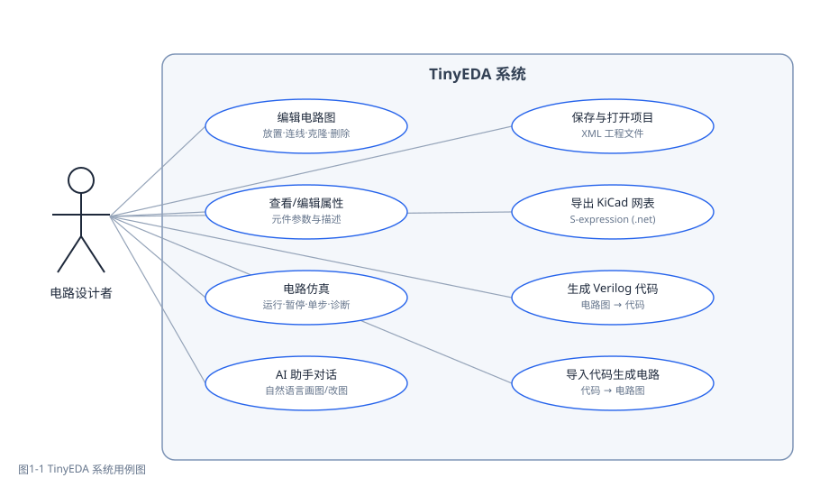
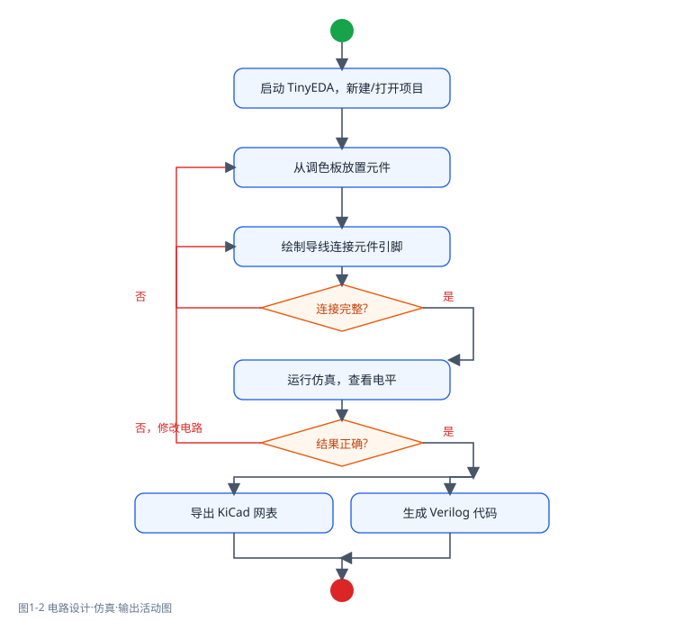

# TinyEDA 系统需求分析报告

## 一、项目概述

TinyEDA 是一个基于 wxWidgets 的简易电子设计自动化（EDA）教学项目：用户可在画布上放置逻辑门与电子元件、绘制导线，查看并编辑元件属性；系统提供电路仿真、KiCad 网表导出、Verilog 代码双向转换与 AI 助手等功能。本报告从软件需求、硬件需求、用例模型与活动模型四方面对系统需求进行分析。

## 二、软件需求

### 2.1 功能需求

| 编号 | 需求 | 优先级 | 说明 |
|---|---|---|---|
| F1 | 图形化电路编辑 | 高 | 放置元件、绘制导线、克隆、删除、移动、旋转/镜像元件，网格吸附 |
| F2 | 元件库管理 | 高 | 142 种元件类型（21 类），SVG 符号 + JSON 元数据，调色板/资源树选取 |
| F3 | 属性查看与编辑 | 高 | 属性栏显示/编辑元件元数据与参数，输入/输出端子显示"仅用于仿真"提示 |
| F4 | 项目文件持久化 | 高 | XML 工程文件（teda-project v1.0）的新建/打开/保存/另存为，加载容错 |
| F5 | 数字逻辑仿真 | 中 | 三值逻辑（0/1/X）组合逻辑仿真；输入端子/开关单击切换电平；导线按电平着色；仿真诊断 |
| F6 | 导出 KiCad 网表 | 中 | 从真实电气连接生成 KiCad 6+ S-expression（.net）；端子存在时中止导出 |
| F7 | Verilog 双向转换 | 中 | 电路图→Verilog 代码；Verilog 代码→电路图（单比特组合逻辑子集） |
| F8 | AI 助手 | 中 | 对话式聊天；调用 11 个画布工具（放置/连线/移动/删除/旋转/镜像等）自动画图；多 API 配置 |
| F9 | 用户配置 | 低 | settings.xml 记录最近文件、默认目录、AI API 配置；分平台路径，读写容错 |

### 2.2 非功能需求

| 类别 | 需求 |
|---|---|
| 跨平台 | Windows（MSVC/MinGW）与 Linux 均能构建、运行 |
| 可维护性 | 模块职责单一（DealProjectXML/Settings/Simulation/Netlist/Agent 等），读写实现收敛到单一模块 |
| 健壮性 | 缺失元件/图片/元数据静默容错；XML 解析失败不破坏画布；仿真/网表输出带结构化诊断 |
| 线程安全 | Agent 网络请求在独立工作线程执行，画布操作经"工具桥"回主线程 |
| 易用性 | 类似 Logisim 的交互；AI 助手支持自然语言画图，降低学习门槛 |

## 三、硬件需求

| 项目 | 最低要求 | 推荐 |
|---|---|---|
| 处理器 | 双核 1.6GHz | 4 核及以上 |
| 内存 | 2 GB | 8 GB |
| 磁盘 | 1 GB 可用空间（含构建缓存） | 5 GB |
| 显卡 | 支持 OpenGL 1.x 的任意显卡（界面为 2D 绘制） | 集成显卡即可 |
| 网络 | 构建首次配置需访问 GitHub（FetchContent 拉取依赖）；运行 AI 助手功能需访问大模型 API | — |
| 操作系统 | Windows 10 / Ubuntu 20.04 等 | Windows 11 / Ubuntu 22.04 |

说明：本软件为轻量级 2D 教学工具，对硬件要求低；仅 AI 助手（F8）需要网络与有效的 API Key，其余功能完全离线可用。

## 四、用例模型

### 4.1 用例图

### 4.2 主要用例描述

| 编号 | 用例 | 参与者 | 前置条件 | 基本流程 | 后置条件 |
|---|---|---|---|---|---|
| UC1 | 编辑电路图 | 电路设计者 | 系统已启动 | ①选择元件②点击画布放置③绘制导线连接引脚④克隆/移动/删除元件 | 电路更新，画布标记"未保存" |
| UC2 | 查看/编辑属性 | 电路设计者 | 画布存在选中元件 | ①选中元件②属性栏显示元数据③修改参数/描述 | 参数写入实例，可随项目保存 |
| UC3 | 保存与打开项目 | 电路设计者 | 无 | ①新建/打开/保存/另存为②选择路径③确认未保存修改 | 项目持久化为 XML 或从 XML 恢复 |
| UC4 | 电路仿真 | 电路设计者 | 已连接完整电路 | ①模拟→运行②单击输入端子/开关切换电平③观察导线/门/灯电平④（可选）查看诊断 | 画布显示三值电平，状态栏更新 |
| UC5 | 导出 KiCad 网表 | 电路设计者 | 电路无输入/输出端子 | ①导出②选择保存路径 | 生成 .net 文件；存在端子时中止并警告 |
| UC6 | 生成 Verilog 代码 | 电路设计者 | 电路含门与端子 | ①打开 Verilog 面板②点击"生成代码" | 面板显示对应 module 代码 |
| UC7 | 导入代码生成电路 | 电路设计者 | 文本框中为合法子集代码 | ①粘贴代码②点击"生成电路" | 画布按拓扑自动布局生成电路 |
| UC8 | AI 助手对话画图 | 电路设计者 | 已配置有效 API Key | ①输入自然语言指令②AI 调用工具（放置/连线等）③显示结果 | 画布按指令更新 |

## 五、活动模型

### 5.1 电路设计·仿真·输出活动图

### 5.2 活动说明

1. **设计阶段**：启动系统并新建/打开项目 → 从调色板放置元件 → 绘制导线连接元件引脚。
2. **校验分支**：检查连接是否完整——不完整则回到绘制导线环节补充连线。
3. **仿真阶段**：运行仿真查看各元件/导线电平。
4. **结果判断**：结果不正确则修改电路（回到放置/连线环节）；正确则进入输出环节。
5. **输出阶段**：按需导出 KiCad 网表或生成 Verilog 代码（两者互不依赖，可分别进行）。

## 六、需求确认

| 需求 | 对应实现 | 验证方式 |
|---|---|---|
| F1 | src/Canva（Canvas/ToolBar/ItemSVG） | 人工操作 + tests/projectxml_selftest.cpp |
| F5 | src/Simulation（Simulator/Validator/Adapter） | tests/simulation_selftest.cpp（61 项）+ tests/simulation_adapter_selftest.cpp（47 项） |
| F6 | src/Netlist（KiCadNetlistExporter） | tests/netlist_selftest.cpp、tests/kicad_export_demo.cpp |
| F7 | src/verilator + src/VerilogBridge | tests/verilog_bridge_selftest.cpp、src/verilator/tests/verilator_selftest.cpp |
| F8 | src/Agent（Controller/Communicate/Skills） | 人工对话 + 设置保存回读测试 |
