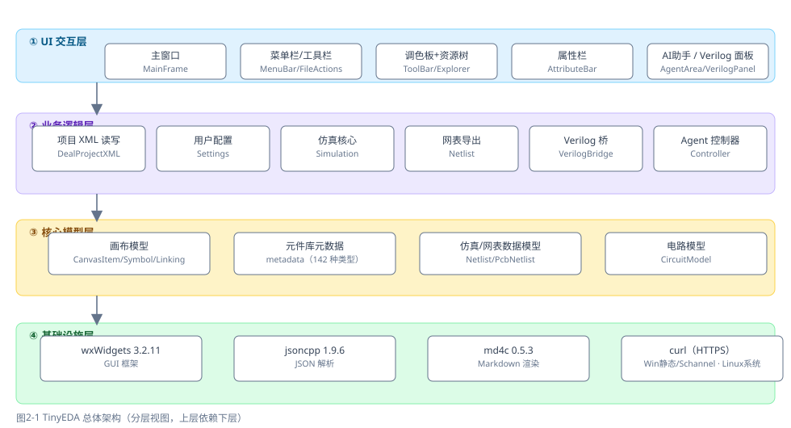
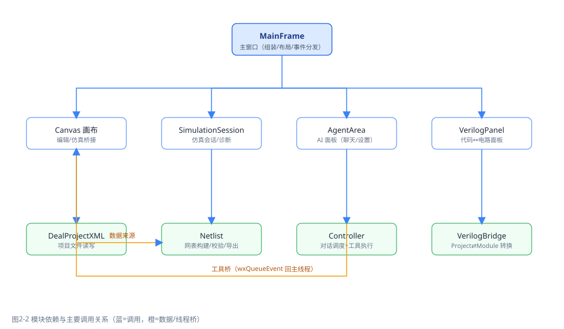

# TinyEDA 系统概要设计报告

## 一、设计目标与原则

1. **模块化**：按职责划分模块（UI / 业务逻辑 / 核心模型 / 基础设施四层），各模块通过明确接口交互。
2. **读写收敛**：项目文件读写只允许 `src/DealProjectXML` 一处实现，用户配置只允许 `src/Settings` 一处实现，避免多套实现冲突。
3. **与 GUI 解耦**：仿真核心（Simulation）、网表导出（Netlist）、Verilog 转换（verilator）均为与 wx 无关的独立模块，可单独自检。
4. **解耦复用**：仿真、网表、Verilog 转换共用同一套"连接关系采集"语义（导线端点按 pin/junction/label/free 处理）。

## 二、总体架构



架构分为四层：

| 层 | 组成 | 职责 |
|---|---|---|
| ① UI 交互层 | MainFrame / MenuBar / ToolBar / Explorer / AttributeBar / AgentArea / VerilogPanel | 界面布局、菜单交互、事件分发、面板折叠 |
| ② 业务逻辑层 | DealProjectXML / Settings / Simulation / Netlist / VerilogBridge / Agent-Controller | 项目读写、仿真会话、网表导出、Verilog 桥、对话调度 |
| ③ 核心模型层 | CanvasItem/Symbol/Linking / metadata / Netlist/PcbNetlist / CircuitModel | 画布数据模型、元件库元数据、领域数据模型 |
| ④ 基础设施层 | wxWidgets / jsoncpp / md4c / curl | GUI 框架、JSON 解析、Markdown 渲染、HTTPS 通信 |

上层依赖下层：UI 只调用业务逻辑层接口，业务逻辑层操作核心模型，基础设施被各层复用。

## 三、模块划分与职责

| 模块 | 主要文件 | 职责 | 对外接口（示例） |
|---|---|---|---|
| 项目文件 | src/DealProjectXML | 项目 XML 读写、画布↔数据模型转换 | SaveProject / LoadProject / CollectFromCanvas / ApplyToCanvas |
| 用户配置 | src/Settings/AppSettings | settings.xml 读写、项目根目录识别、分平台路径 | Load / Save / UserConfigDir / ProjectRootDir |
| 画布 | src/Canva | 元件/导线放置、选中、拖动、删除、克隆、缩放平移、网格 | Canvas::add_item / find_item_by_id / set_view / start_clone |
| 仿真 | src/Simulation | 三值逻辑仿真核心 + 项目适配 + 会话 | Simulator::evaluate / SimulationAdapter / SimulationSession |
| 网表 | src/Netlist | 内部网表构建、校验、KiCad 导出 | NetlistBuilder / NetlistValidator / KiCadNetlistExporter::write |
| Verilog 转换 | src/verilator + src/VerilogBridge | 解析、电路模型、代码生成；项目↔模型桥接 | BuildModuleFromProject / BuildProjectFromModule |
| AI 助手 | src/Agent | 上下文、通信、调度、工具注册表、聊天/设置 UI | Controller::StartChat / SetProfile / Busy |
| 主题 | src/Theme | 颜色/圆角/间距/动效 token、主题化控件 | ThemedButton / ThemedSplitter / CardPanel |

## 四、接口设计

### 4.1 模块依赖图



说明：MainFrame 组装各面板并分发事件；Canvas 与 Simulation 通过 SimulationBridge 交换数据；Agent 的 Controller 通过"工具桥"（wxQueueEvent + 条件变量）把画布操作派回主线程执行，保证线程安全；网表导出从项目 XML 数据构建。

### 4.2 关键接口签名

| 接口 | 所在模块 | 签名 | 用途 |
|---|---|---|---|
| 项目保存 | DealProjectXML | `bool SaveProject(const ProjectData&, const wxString& path)` | 写项目 XML |
| 项目加载 | DealProjectXML | `bool LoadProject(ProjectData&, const wxString& path)` | 读项目 XML（失败保持画布原样） |
| 画布采集 | DealProjectXML | `ProjectData CollectFromCanvas(Canvas*)` | 画布 → 数据模型 |
| 画布应用 | DealProjectXML | `void ApplyToCanvas(const ProjectData&, Canvas*)` | 数据模型 → 画布 |
| 仿真求值 | Simulation | `SimulationResult Simulator::evaluate(const SimulationCircuit&)` | 迭代求值三值逻辑 |
| 仿真会话 | Simulation | `bool SimulationSession::run() / pause() / step()` | 运行/暂停/单步 |
| 网表导出 | Netlist | `KiCadNetlistWriteResult KiCadNetlistExporter::write(const PcbNetlist&, const wxString& path)` | 导出 .net 文件 |
| 图→码 | VerilogBridge | `ProjectToModuleResult BuildModuleFromProject(const ProjectData&, topName)` | 电路 → 电路模型 |
| 码→图 | VerilogBridge | `ModuleToProjectResult BuildProjectFromModule(const Module&, origin)` | 电路模型 → 项目 |
| 对话调度 | Agent | `void Controller::StartChat(const std::string& msg)` | 启动一轮对话（工作线程） |
| 工具执行 | Agent | `ToolResult ToolRegistry::run(const std::string& name, const Json::Value& args)` | 执行画布工具 |

### 4.3 数据流概述

```
用户操作 → MainFrame 事件分发
├─ 放置/连线 → Canvas → (标记未保存) → DealProjectXML::CollectFromCanvas → 保存 XML
├─ 仿真 → SimulationBridge(画布) → SimulationSession → Simulator → 电平回写画布覆盖层
├─ 网表 → DealProjectXML(项目数据) → NetlistBuilder → PcbNetlist → KiCadNetlistExporter → .net
├─ Verilog → ProjectToModule → CircuitModel → VerilogGenerator → 代码；反向 Parser → ModuleToProject → 画布
└─ AI 助手 → Controller(工作线程) → Communicate(curl) ↔ 大模型；Skills 工具经工具桥操作 Canvas
```

## 五、关键设计决策

1. **组合逻辑限定**：仿真与 Verilog 转换仅支持组合逻辑，时序逻辑留待架构级扩展（避免画布/仿真/网表全链路改造）。
2. **Agent 线程模型**：网络请求放工作线程防卡 UI；画布只允许主线程操作，工具桥用 wxQueueEvent 派回主线程并配合条件变量等待结果。
3. **错误信息可诊断**：HTTP 非 2xx 时保留状态码与原始响应体；转换/仿真诊断结构化输出，不静默丢弃。
4. **跨平台收敛**：CMake + FetchContent 统一拉取依赖；MSVC `/utf-8`、`WIN32`、`wx::xml`/`wx::html` 组件、`localtime_r` 兼容宏等平台差异在构建脚本与源码中集中处理。
