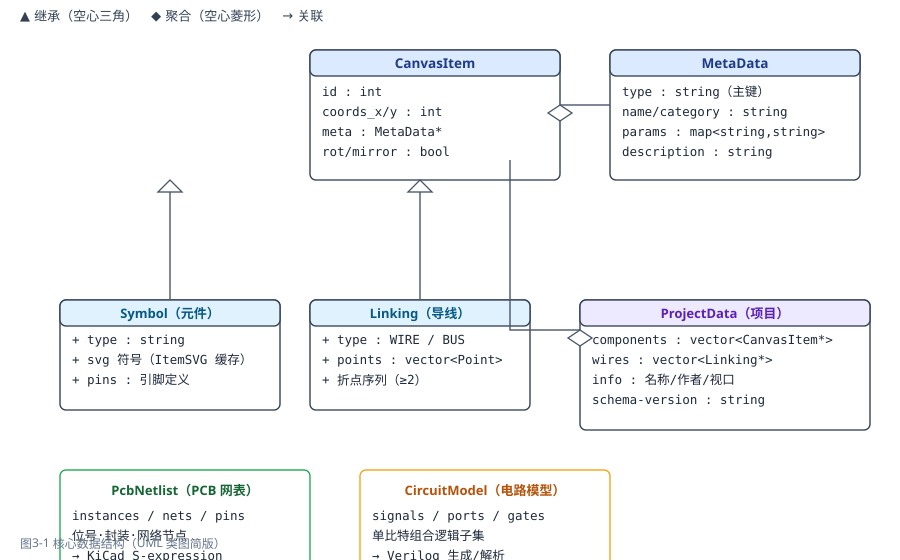
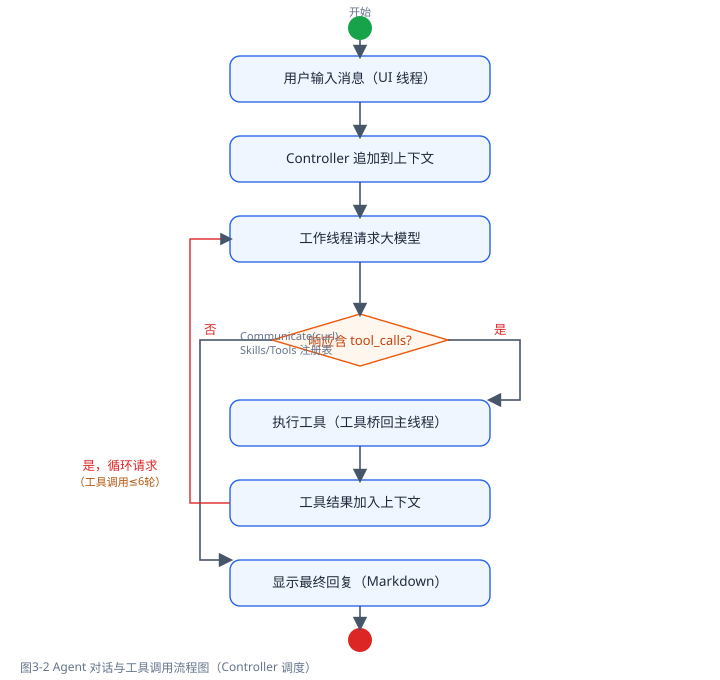
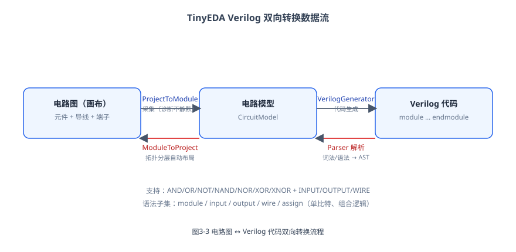

# TinyEDA 系统详细设计报告

## 一、数据结构设计

### 1.1 核心数据结构类图



### 1.2 数据结构说明

| 结构 | 关键字段 | 说明 |
|---|---|---|
| `CanvasItem` | id, coords_x/y, meta, rot/mirror | 画布上所有对象的基类；id 在电路内唯一，坐标为逻辑网格坐标 |
| `Symbol`（继承） | type, svg 符号, pins | 元件：按类型串加载 SVG 与元数据（ItemSVG 共享缓存） |
| `Linking`（继承） | type(WIRE/BUS), points | 导线/总线：折点序列（≥2），电气关系由端点语义决定 |
| `MetaData` | type, name/category, params, description | 元件元数据：type 为主键，params 为通用参数键值对 |
| `ProjectData` | components, wires, info, schema-version | 项目数据模型：XML 读写与画布转换的中间表示 |
| `PcbNetlist` | instances, nets, pins | PCB 网表模型：位号、封装、物理引脚、网络节点 |
| `CircuitModel` | signals, ports, gates | Verilog 电路模型：单比特组合逻辑子集 |

### 1.3 项目文件结构（XML 2.0 语义）

```
teda-project (schema-version)
├── info         项目信息（名称/作者/时间/描述/画布视口 view）
└── circuit
    ├── component  元件（type 为元数据主键；description/param 可覆盖默认值）
    └── wire       导线（param + point 折点序列）
```

加载容错：未知元素/字段忽略，缺失 type 按空元数据创建，解析失败画布保持原样。

## 二、核心功能模块流程

### 2.1 Agent 对话与工具调用流程



流程要点：

1. 用户在 UI 线程输入消息，`Controller::StartChat` 启动工作线程；
2. 上下文（Context）追加用户消息后，`Communicate::ChatCompletions` 以 curl 发起 HTTPS 请求（可中断）；
3. 响应含 `tool_calls` 时：逐个工具经"工具桥"回主线程执行（画布只能主线程操作），结果加入上下文后**循环请求大模型**，最多 6 轮；
4. 响应为纯文本时显示最终回复（md4c 渲染 Markdown）。

### 2.2 Verilog 双向转换流程



- **图 → 码**：`ProjectToModule` 采集画布门/端子/导线 → `CircuitModel` → `VerilogGenerator` 输出 module 代码；
- **码 → 图**：`Parser`（词法/语法 → AST）→ `CircuitModel` → `ModuleToProject` 按拓扑分层自动布局生成元件坐标与导线，落回画布。

## 三、主要算法与机制

| 机制 | 实现要点 |
|---|---|
| 网格吸附 | 元件坐标与导线折点吸附到逻辑网格（默认步长 10），`GridStep` 随项目保存 |
| 连接关系采集 | 导线端点按 pin / junction / label / free 语义处理；同名 label（同 scope）视为同一网络；旧 1.0 项目按坐标重合兜底 |
| 三值仿真求值 | `LogicValue`（0/1/X）；`Simulator` 按真值表迭代求值多级组合逻辑；悬空/多驱动经 `SimulationValidator` 诊断 |
| 仿真-画布桥接 | `SimulationBridge` 解析元件引脚按实例旋转/镜像变换为绝对坐标，搬运导线端点/junction/label/no-connect |
| Agent 工具桥 | 工具 handler 只能主线程执行：Controller 工作线程经 `wxQueueEvent` 派发 `ToolExecuteRequestEvent`，主线程执行后经条件变量唤醒返回，`shutdown_` 支持析构唤醒 |
| KiCad 网表 | `PcbNetlist` 序列化为 export version "E" 的 S-expression，结构对照 KiCad 10.0.6（kicad-cli）参考网表核对 |
| 错误诊断 | HTTP 非 2xx 保留状态码与原始响应体（非 JSON 时贴原文截断）；转换/仿真诊断结构化（severity/code/message） |

## 四、界面设计

| 区域 | 构成 | 交互 |
|---|---|---|
| 左侧栏 | 元件调色板 + 资源树（CardPanel） | 点击进入放置模式，属性栏同步预览 |
| 中部 | 画布 + 属性栏 | 选择/删除/克隆工具切换；属性栏编辑参数 |
| 最右 | AI 助手面板（F12）/ Verilog 面板（F11） | 分段页签（对话/设置）；面板可折叠，菜单勾选同步 |
| 底部 | 状态栏四段 | 提示 / 光标坐标 / 缩放网格 / 仿真摘要 |
| 聊天气泡 | 用户右蓝·AI 左绿、圆形头像、工具块默认展开可折叠、错误红底 | md4c 渲染 Markdown，自动滚动到底部 |

主题统一由 `src/Theme` 提供：颜色/圆角/间距/动效 token、ThemedButton（抗锯齿圆角+阴影+动效）、ThemedSplitter（自绘抓手）、CardPanel（圆角卡片）。
