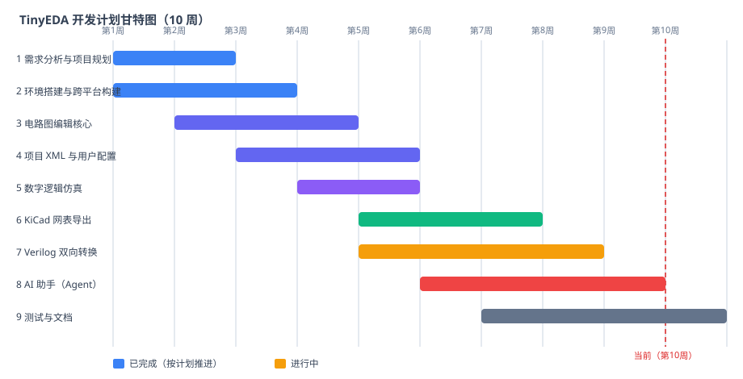

# 附录B：软件过程协作

> 本附录记录软件过程计划、实施结果对计划的偏差，以及小组分析讨论过程纪要。

## 一、软件过程计划

由项目经理（组长）主导、成员共同参与制定，以 10 周为周期，按需求分析 → 设计 → 编码 → 测试 → 文档的顺序推进。计划用甘特图与表格两种形式呈现。

| 序号 | 计划内容 | 计划时间 | 完成时间 | 完成状态 |
|---|---|---|---|---|
| 1 | 需求分析与项目规划 | 第 1–2 周 | 第 2 周 | 已完成 |
| 2 | 环境搭建与跨平台构建 | 第 1–3 周 | 第 3 周 | 已完成 |
| 3 | 电路图编辑核心 | 第 2–4 周 | 第 4 周 | 已完成 |
| 4 | 项目 XML 与用户配置 | 第 3–5 周 | 第 5 周 | 已完成 |
| 5 | 数字逻辑仿真 | 第 4–6 周 | 第 6 周 | 已完成 |
| 6 | KiCad 网表导出 | 第 5–7 周 | 第 7 周 | 已完成 |
| 7 | Verilog 双向转换 | 第 5–8 周 | 第 8 周 | 已完成 |
| 8 | AI 助手（Agent） | 第 6–9 周 | 第 9 周 | 已完成 |
| 9 | 测试与文档 | 第 7–10 周 | 第 10 周 | 已完成（报告撰写中） |

## 二、实施结果对计划的偏差记录

| 序号 | 计划项 | 偏差描述 | 原因分析 | 处理措施 |
|---|---|---|---|---|
| 1 | 电路图编辑核心 | 比计划多用约半周 | 元数据/SVG 符号加载与网格吸附细节多于预期 | 拆分为"画布交互"与"符号加载"两个子任务并行；后续任务排期预留缓冲 |
| 2 | 数字逻辑仿真 | 比计划提前约 1 周完成 | 仿真核心与 GUI 解耦设计，可独立开发测试 | 提前进入网表/Verilog 任务，为后续争取时间 |
| 3 | KiCad 网表导出 | 格式核对比计划多花约 1 周 | 需要对照 KiCad 10 参考网表逐字段核对，保证可被 KiCad 读取 | 用 kicad-cli 生成参考网表做对比测试，固化为自检用例 |
| 4 | AI 助手（Agent） | 与计划基本一致 | — | 实测中发现 3 个隐蔽 bug（网络中断误触发、错误体误报、配置不加载），在计划内修复并回归 |
| 5 | 测试与文档 | 文档撰写与报告整理安排在最后 2 周集中完成 | 测试用例随各模块开发持续补充，报告统一汇总 | 各模块自检随编码同步维护，报告期只做汇总与核对 |

**偏差小结**：总体进度与计划基本吻合，个别任务（网表核对、电路编辑细节）略有延迟，靠模块解耦与提前完成任务吸收；未出现影响交付的里程碑级延期。

## 三、小组分析讨论过程纪要

### 3.1 第 1 次讨论（第 1 周）——需求与分工

- **议题**：确定系统范围（教学 EDA 工具）、功能优先级（电路编辑 > 仿真 > 网表/Verilog > AI 助手）。
- **决议**：采用"规划文档先行"——每个模块开工前先写规划文档并核对源码现状；建立 main/verilator/feat/agent/simulation 分支并行开发。
- **分工**：项目经理负责整体计划与文档；成员按模块认领（画布/仿真/网表/Verilog/AI）。

### 3.2 第 2 次讨论（第 4 周）——跨平台构建与依赖

- **议题**：Windows（MSVC/MinGW）与 Linux 双平台构建不一致问题。
- **决议**：统一 CMake + FetchContent；把平台差异（WIN32、/utf-8、wx::xml、localtime_r、curl 静态编译）收敛进构建脚本与源码宏；README 记录注意事项。
- **结论**：双平台构建流程收敛为两条 cmake 命令，新成员按 README 可复现。

### 3.3 第 3 次讨论（第 6 周）——仿真与网表复用

- **议题**：仿真、网表、Verilog 三条链路都需要"连接关系"，避免三套采集逻辑。
- **决议**：统一采用导线端点 pin/junction/label/free 语义采集，同名 label 视为同一网络；旧 1.0 项目按坐标重合兜底；仿真核心与 GUI 解耦。
- **结论**：三处共用同一套拓扑能力，减少重复实现与不一致风险。

### 3.4 第 4 次讨论（第 9 周）——AI 助手疑难 bug 与线程安全

- **议题**：实测中"发送消息立即报错"（先报网络中断、后报 HTTP 401 非 JSON）。
- **分析**：第一个 bug 是 `std::function<bool()>` 在布尔上下文误调 `operator bool()`，导致进度回调恒中断请求；第二个 bug 是 HTTP 401 响应体非 JSON 时误报"响应不是合法JSON"，掩盖了真实原因（未提供 API Key）；此外 Controller 启动时不加载已保存的 API 配置。
- **决议**：修复回调调用方式（`(*abort)()`）；非 2xx 先检查状态码再解析，响应体非 JSON 时贴原文；Controller 构造时加载设置；并用 headless 探针（空 key/无效 key/中断三态）验证。
- **结论**：三个 bug 全部修复并回归；错误信息从"黑箱"变为可诊断。

### 3.5 第 5 次讨论（第 10 周）——验收与报告

- **议题**：功能验收清单、测试覆盖汇总、实验报告分工。
- **决议**：按《04-测试用例报告》18 项黑盒用例 + 200+ 项白盒自检验收；实验报告按"需求/概要/详细/测试/工具应用/过程协作"六部分分工撰写，图片统一用 SVG 生成。
- **结论**：系统功能与文档达到交付标准，进入报告整理阶段。

### 3.6 讨论机制小结

- 每周例会 + 里程碑节点专题讨论；所有决议落到规划文档/README，确保成员一致；
- 讨论纪要在本项目文档中归档（本附录），偏差记录用于复盘改进。
