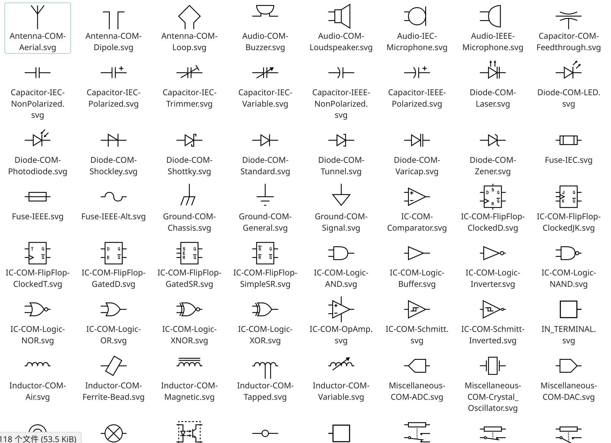
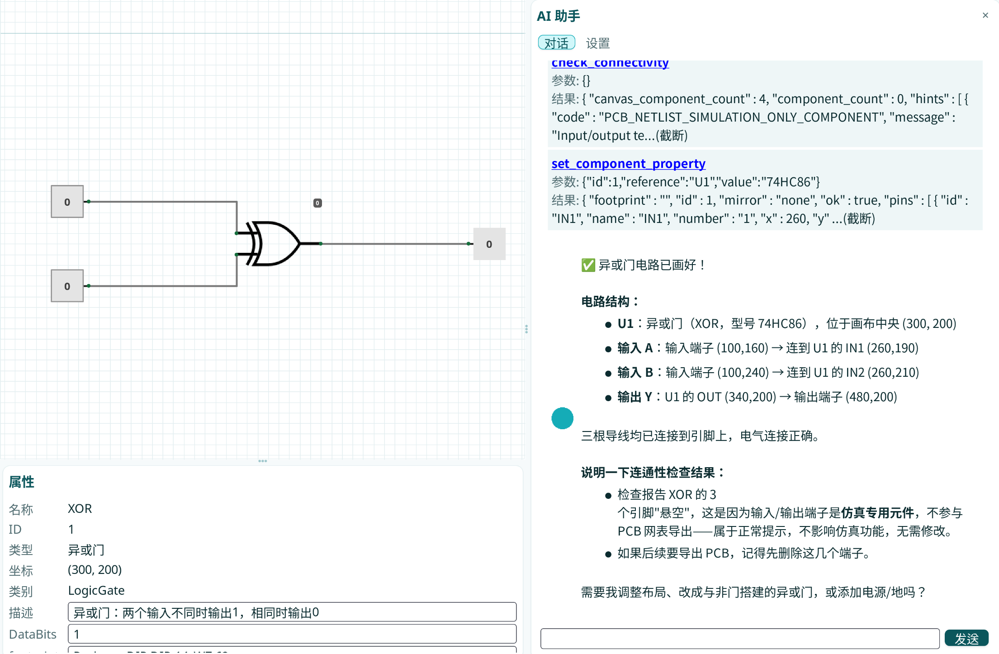
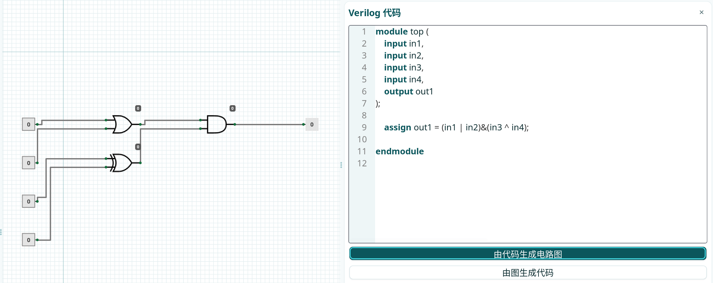

# 需求分析

本项目是一个基于 **wxWidgets** 的简易电子设计自动化（EDA）教学工具——**TinyEDA**，目标是在画布上以图形方式完成数字逻辑电路的设计、仿真与导出，并通过 AI 助手降低使用门槛。结合课堂实验与团队规划文档，整理出以下核心需求：

| 编号 | 需求 | 说明 |
|---|---|---|
| R1 | 图形化电路编辑 | 在画布上放置逻辑门与电子元件、绘制导线，支持克隆、删除、移动元件并编辑属性；元件符号与元数据可扩展 |
| R2 | 项目文件持久化 | 以单个 XML 文件保存项目（含项目信息与电路图），支持新建/打开/保存/另存为，加载容错、版本兼容 |
| R3 | 导出 KiCad PCB 网表 | 从项目**真实电气连接**生成 KiCad 6+ 的 S-expression 网表（`.net`），供兼容的 KiCad 工作流使用 |
| R4 | Verilog 与电路图双向转换 | 支持单比特组合逻辑子集：电路图 → Verilog 代码、Verilog 代码 → 电路图 |
| R5 | 交互式数字逻辑仿真 | 类似 Logisim 的三值逻辑仿真（组合逻辑范围），输入端子/开关驱动，导线与元件按电平着色 |
| R6 | AI 助手 | 对话式交互，可调用内部工具直接读取/修改画布（画图、连线、旋转镜像等），多 API 配置 |
| R7 | 跨平台 | 不依赖 Visual Studio 工程，使用 CMake 在 Windows 与 Linux 上均可开发、构建、部署 |

约束与取舍（明确写入规划文档）：仿真与 Verilog 转换**只做组合逻辑**，时序逻辑（触发器、时钟）留待架构级扩展；导出网表与仿真网表解耦，复用底层拓扑解析能力。

# 系统设计成果

整体采用「模块化 + 规划文档先行」的架构：`src/DealProjectXML` 独占项目文件读写，`src/Canva` 负责画布交互，`src/Simulation` 为与 GUI 无关的仿真核心，`src/Netlist` 负责网表导出，`src/verilator` + `src/VerilogBridge` 负责 Verilog 双向转换，`src/Agent` 负责 AI 助手。元件库含 **142 种元件类型**（21 个分类元数据 JSON + SVG 符号），由 `src/metadata` 统一管理。

## 编辑电路图

- **画布引擎**（`src/Canva/Canvas.*`）：逻辑坐标系 + 缩放/平移 + 网格吸附（默认步长 10）；`CanvasItem`/`Symbol`/`Linking` 数据模型；`ItemSVG` 按类型串加载 SVG 与元数据（共享缓存，缺失静默容错）。
- **放置电路**：左侧栏 = 元件调色板（`ToolBar`，继承圆角卡片样式）+ 资源树（`Explorer`），点击即进入放置模式，属性栏同步显示"待放置"预览。
- **导线连接**：正交折线绘制，导线端点按 XML 2.0 的 `pin / junction / label / free` 语义采集连接关系，同名 label（同 scope）视为同一网络；旧 1.0 项目按坐标重合兜底。
- **克隆元件**：`clone_item` 复制元件（含元数据、分配新 ID），克隆件可独立编辑。
- **删除元件**：画布提供删除工具，删除后相关导线关系同步处理；选中移动、按网格吸附。
- **属性编辑**：`AttributeBar` 显示并编辑元件元数据与通用参数；输入/输出端子显示"仅用于仿真"提示。
- **项目文件**：`teda-project`（schema-version 1.0）= `info`（项目名/作者/时间/描述/画布视口）+ `circuit`（component/wire），未知元素与字段加载时忽略，缺失 type 按空元数据创建。

## 导出Kicad网表

- **内部网表模型**（`src/Netlist/`）：`NetlistBuilder` 从项目快照（`PcbProjectAdapter`）与元件库快照构建 `PcbNetlist`，表达元件位号、元件值、封装、物理引脚编号与网络节点；`NetlistValidator` 校验结构与引用关系。
- **真实连接而非线段外观**：电气关系从导线端点语义（pin/junction/label/free）采集，不根据画布线段外形推断。
- **输出格式**：`KiCadNetlistExporter` 序列化为 KiCad 6+ 通用 export version "E" 的 S-expression，结构与字段已用 **KiCad 10.0.6**（`kicad-cli sch export netlist`）生成的参考网表及 `kicad_netlist_reader.cpp` 核对。
- **约束**：画布上存在输入/输出端子（`IN_TERMINAL`/`OUT_TERMINAL`，仅仿真测试用）时弹出警告并**中止导出**；校验失败返回结构化诊断。
- 配套自检：`tests/netlist_selftest.cpp`、`tests/kicad_export_demo.cpp`。

## verilog与电路图互转换

- **独立核心**（`src/verilator/`）：词法/语法解析器（`parser/`）、AST、`CircuitModel` 电路模型、`generator/VerilogGenerator` 代码生成；只支持单比特、组合逻辑子集。
- **支持的元件**：AND / OR / NOT / NAND / NOR / XOR / XNOR / INPUT / OUTPUT / WIRE；**支持的语法**：`module`/`endmodule`、单比特 `input`/`output`、`wire`、`assign` 及 `~ & | ^ ~^` 运算符。
- **桥接层**（`src/VerilogBridge/`）：`ProjectToModule` 把画布项目（门、端子、电源/地、导线/junction/label）采集为电路模型；`ModuleToProject` 反向把电路模型展开为扁平项目，**元件坐标由拓扑分层自动布局生成**。
- **UI**（`src/VerilogPanel/`）：文本框 + "生成电路 / 生成代码"按钮，双向一键转换；面板可折叠（F11）。
- 不支持的元件、多重驱动、悬空门输入等写入 diagnostics，**不静默丢弃**；自检 `tests/verilog_bridge_selftest.cpp`、`src/verilator/tests/verilator_selftest.cpp`。

# 项目亮点

## agent

- **对话式聊天 UI**（`src/Agent/UI/ChatPanel.*`）：用户消息靠右（蓝色圆形头像 + 浅蓝气泡）、AI 靠左（绿色圆形头像 + 白气泡）、工具调用为浅黄独立区块（默认展开、点击头部可折叠）、错误红底气泡；AI 回复用 **md4c** 渲染 Markdown（标题/列表/代码块/表格/删除线，并禁用原始 HTML 注入）。
- **多 API 配置**（`src/Agent/UI/Setting.*`）：新增/删除/切换多个 API profile（base_url / api_key / model），保存进用户配置，**重启后 Controller 自动加载当前选中的配置**。
- **工具调用体系**（`src/Agent/Skills/`）：注册表 11 个画布工具——`get_canvas_state`、`list_available_components`、`place_component`、`connect_wire`、`move_component`、`delete_component`、`rotate_component`、`mirror_component`、`set_component_property`、`set_view`、`check_connectivity`；函数描述/参数 Schema 全部写在 `list.xml`，AI 按需调用。
- **调度架构**（`src/Agent/Controller.*` + `Communicate.*` + `Context.*`）：多轮对话循环（最多 6 轮工具调用），HTTP 请求在**工作线程**执行（curl + 进度回调可中断），画布操作经"工具桥"（wxQueueEvent + 条件变量）**派回主线程**执行，保证线程安全；错误信息保留 HTTP 状态码与原始响应体，便于诊断。
- 面板常驻菜单栏（F12 折叠/展开），可见时才占据右侧空间，可拉伸。

## verilog代码

- **优点**：对于重复模块（如行波加法器、多级组合逻辑），**直接写代码比逐个连接电路图更方便**——代码天然具备可复用性与可读性，而电路图要反复拖放元件、走线。
- 双向转换以统一的 `CircuitModel` 为中间表示，保证"图 → 码 → 图"一致。

### 由图生成代码

- `ProjectToModule` 采集画布上的门、输入/输出端子、电源/地、导线与网络标签 → `CircuitModel` → `VerilogGenerator` 输出单模块 Verilog（含 `module` 声明、端口与 `assign` 语句）；接线信息不丢失，多重驱动/悬空输入会被诊断出来。

### 由代码转化为图

- 解析 `module`/`assign` 等语法 → AST → `CircuitModel` → `ModuleToProject` **按拓扑分层自动布局**生成元件坐标与导线，落回画布项目（端口端子 + 门 + 电源/地 + 导线），可继续编辑与仿真。

# 开发过程

## 跨平台构建

- **用 CMake 管理项目而不是 Visual Studio 工程**：`cmake -S . -B build` 配置 + `cmake --build build --target TinyEDA` 编译，一条命令完成；在 Windows（MSVC 与 MinGW-w64）与 Linux 上均能开发、构建、部署，简化编译流程。
- **依赖自动获取**：`FetchContent` 自动拉取 wxWidgets 3.2.11、jsoncpp 1.9.6、md4c 0.5.3；Windows 下额外静态编译 curl（TLS 用系统 Schannel，无需 OpenSSL）；Linux 链系统 libcurl——按平台分流。
- **平台差异收敛进构建与源码**：`add_executable(... WIN32 ...)` 解决 MSVC 入口符号；`/utf-8` 解决中文源码按本地代码页解析的乱码；链接 `wx::xml`/`wx::html` 组件；`localtime_r` 兼容宏覆盖 MSVC/MinGW；`file(GLOB_RECURSE ... CONFIGURE_DEPENDS)` 自动收录新增源文件；`run_TinyEDA.bat` 自动补齐第三方 DLL 与工作目录。

## 文档交接

- **统一规划，避免冲突，明确目标**：每个功能模块在编码前先写规划文档并核对源码现状——`网表规划.md`、`Verilog扩展规划.md`、`Verilator规划.md`、`仿真任务规划.md`、`XML更新规划.md`、`XML与元数据json升级计划的规划.md`，以及 Agent 设计文档 `src/Agent/UseAgent.md`。
- **README 作为活文档**：代码结构表、XML 格式规范、平台注意事项、已知问题与约定全部沉淀在 `README.md`，交接新成员/队友拉取更新后按文档即可复现构建。
- **约定收敛**：项目文件读写只允许 `src/DealProjectXML` 一处实现、用户配置只允许 `src/Settings`——避免多套实现互相冲突。

## 分支管理

- **并行开发、定期合并**：`main`（主分支）、`verilator` / `verilator-v2`（Verilog 转换）、`feat/agent`（AI 助手）、`simulation`（仿真）等分支并行推进，各自独立验证后合并回主干（如 `Merge remote-tracking branch 'origin/main' into feat/agent`、`第一次 合并main和verilator`）。
- 主干保持可构建：合并记录显示仿真 2.0、Verilog 与电路图互转、Agent 工具增强等里程碑依次落地；仓库累计 **62 个提交**，README/规划文档同步更新。
